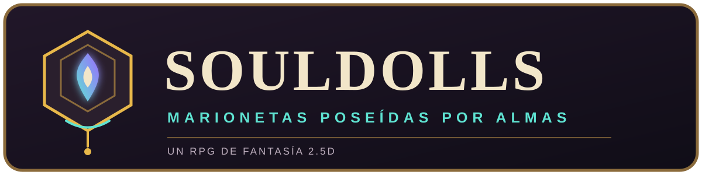
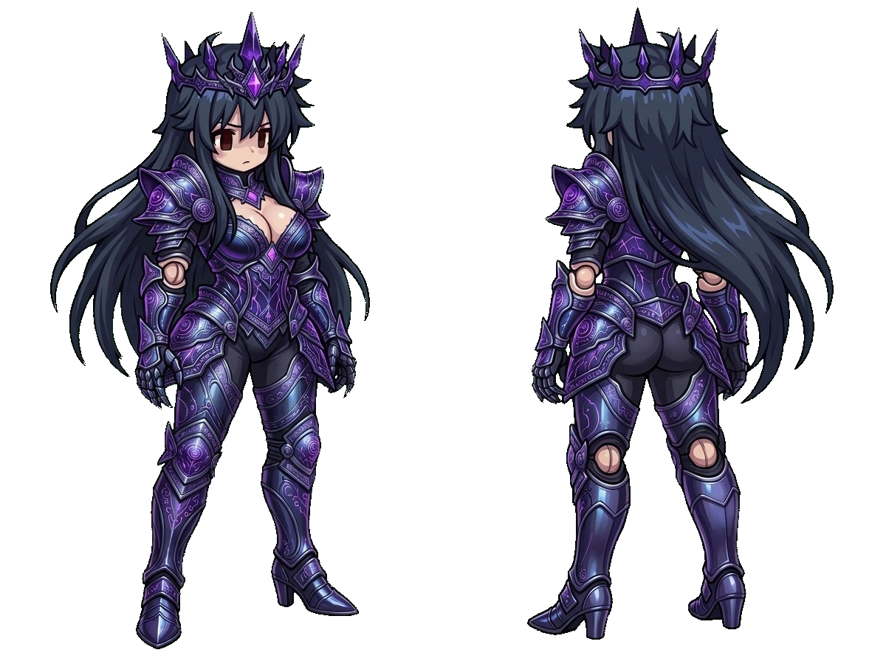
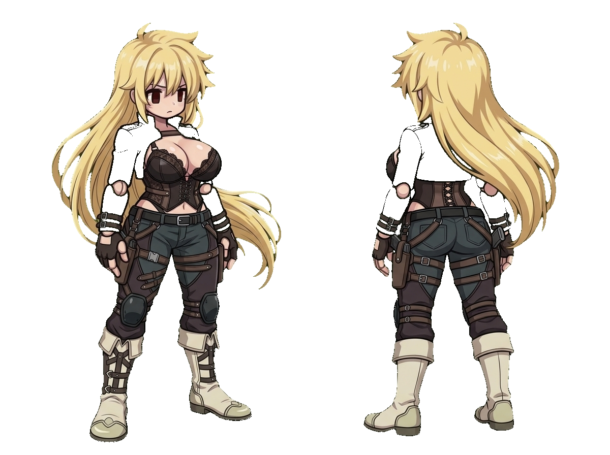
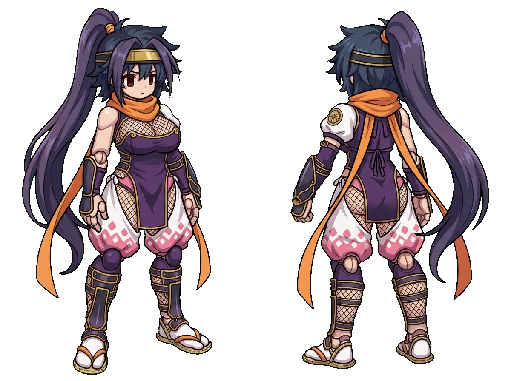

<!--
  SoulDolls — README orientado a personas y agentes de IA.
  Mantener los datos técnicos sincronizados con package.json y src/.
-->

<p align="center">
  
</p>

<p align="center">
  <a href="https://souldolls.vercel.app/"></a>
  <a href="https://github.com/Leemonztuff/Soul-Dolls-2.5d"></a>
</p>

<p align="center">
  
  
  
  
  
  
</p>

<p align="center">
  <strong>Un RPG 2.5D de exploración, captura y evolución de marionetas habitadas por almas.</strong><br />
  <sub>Desarrollado para navegador, móvil y escritorio · Interfaz y contenido en español</sub>
</p>

---

## ¿Qué es SoulDolls?

**SoulDolls** es un RPG de fantasía 2.5D en el que exploras distintas regiones, encuentras marionetas salvajes, sellas sus almas con **Soulpots** y las vinculas a cuerpos contenedores para formar tu equipo. Después las entrenas, evolucionas y utilizas sus afinidades y habilidades en **combates por turnos**.

El mundo combina escenarios 3D de baja complejidad con personajes y criaturas pixel-art tipo billboard. La dirección visual mezcla fantasía, magia, bronce y una paleta oscura con acentos cian y violeta.

**Bucle principal:** explorar → encontrar SoulDolls → combatir → sellar almas → construir y mejorar cuerpos → entrenar/evolucionar → avanzar en misiones.

## Dirección de diseño aprobada (20/11/2026)

La dirección vigente del juego está documentada en **[docs/SOULDOLLS_DESIGN.md](docs/SOULDOLLS_DESIGN.md)**. Las decisiones principales son:

- RPG anime ecchi de intensidad muy alta; los personajes que participen en contenido ecchi son adultos.
- Protagonista masculino fijo; el romance no es el eje del juego.
- Aventura por capítulos y regiones diseñadas, no mundo abierto procedural infinito.
- SoulDolls: muñecas artificiales habitadas por almas, personalizables mediante piezas intercambiables.
- Combate por turnos estilo Pokémon: encuentros normales 1 contra 1; jefes y encuentros especiales con tres SoulDolls aliadas activas, sinergias y un jefe individual o hasta tres enemigos.
- Captura mediante debilitamiento, dispositivo y probabilidad condicionada.
- Progresión clásica por niveles, experiencia, habilidades y evolución.
- Objetivo de 10–15 horas para la historia principal y 50–70 SoulDolls.

**Importante:** estas son decisiones de diseño aprobadas, no una declaración de que todas las funciones estén implementadas. El documento de diseño separa explícitamente objetivos futuros del estado real del código.

---
## Instrucciones para agentes IA

- **OpenCode:** carga `AGENTS.md` automáticamente.
- **Gemini CLI:** carga `GEMINI.md`, que importa las reglas comunes y el documento de diseño.
- **Skills compartidas:** `.agents/skills/` es la ubicación interoperable para Gemini CLI y OpenCode.
- **Fuente de verdad:** `docs/SOULDOLLS_DESIGN.md`; el código fuente determina qué está realmente implementado.

Al iniciar una sesión nueva, Gemini puede comprobar el contexto con `/memory show` y las skills con `/skills list`. En OpenCode, inicia una sesión nueva después de cambiar instrucciones y activa las skills según la tarea.

---
## Estado del proyecto

<kbd>En desarrollo activo</kbd>

El repositorio contiene un juego ejecutable y sistemas jugables en evolución. No debe interpretarse como una versión final ni como una promesa de contenido terminado. La demo pública corresponde al estado desplegado más reciente.

- **50 especies** registradas en el catálogo actual.
- **8 afinidades**: Brasa, Marea, Flora, Chispa, Roca, Brisa, Umbra y Común.
- **3 SoulDolls iniciales** para elegir al comenzar.
- Evolución, habilidades, estados alterados, captura y combates por turnos.
- Cuerpos contenedores intercambiables, afinidad, armas y daño por partes.
- Exploración, NPC, diálogos, misiones, encuentros, tiendas y guardado local.
- Sistemas adicionales: Grimorio, álbum de cartas, logros, academia de habilidades, viviendas y eventos.

## Ver y jugar

| Recurso | Enlace |
| --- | --- |
| Demo jugable | [souldolls.vercel.app](https://souldolls.vercel.app/) |
| Galería de criaturas dentro del juego | [Abrir galería](https://souldolls.vercel.app/?gallery=1) |
| Código fuente | [GitHub](https://github.com/Leemonztuff/Soul-Dolls-2.5d) |
| Desarrollador | [@Leemonztuff](https://github.com/Leemonztuff) |

### Arte del juego

Las capturas de gameplay todavía no están versionadas en el repositorio. Para no presentar imágenes ficticias como si fueran capturas reales, esta sección muestra hojas de sprites que sí forman parte de los assets del juego. La galería interactiva de arriba permite ver las criaturas dentro de la aplicación.

<p align="center">
  
  
  
</p>
<p align="center"><sub>Hojas de sprites incluidas en public/assets/souldolls/ · Vistas frontal y posterior</sub></p>

## Stack tecnológico

| Área | Tecnología | Responsabilidad |
| --- | --- | --- |
| Lenguaje | TypeScript 7 | Código y contratos tipados |
| UI | React 19 | Interfaces, menús y HUD |
| Render 3D | Three.js 0.187 | Mundo, cámara, terreno y escenas |
| Tooling | Vite 8 | Desarrollo y build |
| Tests | Vitest 5 | Pruebas unitarias |
| Persistencia | localStorage | Opciones y partidas locales |
| Instalación | PWA / Web App Manifest | Instalación compatible con navegador |
| Hosting | Vercel | Demo web desplegada |

## Empezar en local

**Requisitos:** Node.js compatible con Vite 8 y npm.

```bash
git clone https://github.com/Leemonztuff/Soul-Dolls-2.5d.git
cd Soul-Dolls-2.5d
npm install
npm run dev
```

Abre la URL local que muestra Vite.

### Comandos

```bash
npm run dev       # Servidor de desarrollo
npm run build     # Build de producción
npm run preview   # Previsualizar el build
npm run lint      # TypeScript: tsc --noEmit
npm run test      # Suite Vitest
```

## Controles

| Acción | Teclado |
| --- | --- |
| Mover | WASD o flechas |
| Correr | Shift o X |
| Girar cámara | Q / E |
| Acción / confirmar | Z / Enter |
| Menú | M |

En pantallas táctiles se muestran controles en pantalla: cruceta de movimiento, gesto horizontal para girar la cámara y botones de acción/correr. El juego está diseñado para jugarse en **orientación horizontal**.

## Arquitectura del código

Las reglas de trabajo para agentes están centralizadas en [AGENTS.md](AGENTS.md), y la dirección de diseño aprobada en [docs/SOULDOLLS_DESIGN.md](docs/SOULDOLLS_DESIGN.md). Las skills interoperables se encuentran en `.agents/skills/` (la carpeta histórica `.agent/skills/` se conserva sincronizada). Para combate, consulta `.agents/skills/souldolls-combat/SKILL.md`.

El juego está organizado por responsabilidades. Antes de modificar una mecánica, localiza su lógica y conserva el flujo existente.

```text
src/
├── core/             # Game, loop, input, eventos y pila de escenas
├── domain/           # Reglas del juego: combate, daño, captura, evolución,
│                     # criaturas, misiones, inventario y progresión
├── data/             # Catálogos de especies, movimientos, objetos,
│                     # encuentros, mapas, cuerpos y contenido
│   └── maps/         # Definiciones de mapas y generador de zonas
├── engine/           # Three.js: cámara, renderer, terreno, billboards y efectos
├── scenes/           # Título, tutorial, mundo, combate, evolución, tiendas y eventos
├── gfx/              # Paletas, sprites, atlas y proveedores de assets
├── ui/               # Sistemas de interfaz, HUD y controles táctiles
├── components/ui/    # Componentes React de las interfaces
├── save/             # Guardado, carga y migraciones
├── audio/            # Síntesis de audio y efectos
└── i18n/             # Textos e idioma del juego
```

### Zonas principales registradas

Villa Origen, Laboratorio de Origen, Taller de Marionetas, Ruta 1, Pueblo Bruma, Ruta 2, Cueva Eco y Arena Cumbre. También existen interiores y mapas auxiliares generados desde los datos de viviendas.

## Guía rápida para agentes de IA

> **Objetivo:** entender el juego y su arquitectura antes de editar. Este bloque es el punto de entrada recomendado para cualquier agente de programación.

1. Lee este README, `AGENTS.md` y `docs/SOULDOLLS_DESIGN.md`; después inspecciona los archivos relacionados con la tarea.
2. **`src/core/Game.ts`** es el orquestador principal: inicializa sistemas, escenas, opciones y guardado.
3. **`src/domain/`** contiene las reglas de juego. Reutiliza sus funciones antes de duplicar lógica en escenas o UI.
4. **`src/data/`** es la fuente de verdad del contenido. Especies, movimientos, objetos y mapas deben seguir siendo data-driven.
5. **`src/scenes/`** coordina los flujos jugables; **`src/engine/`** implementa la capa Three.js.
6. **`src/ui/`** y **`src/components/ui/`** contienen la interfaz y sus componentes.
7. **`src/save/`** controla persistencia y migraciones. Si cambia el formato guardado, revisa compatibilidad con partidas existentes.

### Reglas de trabajo para agentes

- No reemplazar el proyecto ni migrar de stack: trabajar sobre la arquitectura existente.
- Respetar `docs/SOULDOLLS_DESIGN.md` como fuente de verdad de diseño y `AGENTS.md` como reglas del harness de agentes.
- Separar siempre diseño objetivo de funcionalidad implementada; no presentar jefes de tres enemigos simultáneos como función existente hasta verificarlo en código.
- No duplicar sistemas que ya existan en `domain/`, `core/` o `engine/`.
- Mantener separadas las reglas de dominio, la presentación React y el render Three.js.
- Priorizar cambios pequeños, localizados y compatibles con los datos/partidas actuales.
- Para contenido nuevo, preferir catálogos y definiciones data-driven en `src/data/`.
- No afirmar que una mecánica está terminada sin comprobar su implementación real.
- Ejecutar las verificaciones adecuadas al cambio: `npm run lint`, `npm run test` y/o `npm run build`.

### Archivos de entrada frecuentes

| Si vas a trabajar en… | Empieza por… |
| --- | --- |
| Flujo general / inicialización | `src/core/Game.ts` |
| Reglas de combate | `src/domain/BattleEngine.ts`, `src/domain/Damage.ts`, `.agents/skills/souldolls-combat/SKILL.md` |
| Sincronización de impactos | `src/domain/BattleImpactSync.ts`, `src/scenes/BattleScene.ts` |
| Captura | `src/domain/Catch.ts` |
| Especies y movimientos | `src/data/species.ts`, `src/data/moves.ts` |
| Mapas y encuentros | `src/data/maps/`, `src/data/encounters.ts` |
| Cámara | `src/engine/CameraRig.ts`, `src/domain/CameraOrbit.ts` |
| Opciones y guardado | `src/save/SaveManager.ts`, `src/save/migrations.ts` |
| UI / HUD | `src/components/ui/`, `src/ui/` |

## Dirección visual

La paleta central combina tinta oscura, madera ahumada y bronce con porcelana, cian Ki y violeta Alma:

| Color | Hex |
| --- | --- |
| Fondo / tinta | `#14101C` |
| Madera ahumada | `#2A1F2D` |
| Bronce antiguo | `#8A6A3B` |
| Oro resonante | `#E8B84A` |
| Porcelana | `#F2E6C9` |
| Ki cian | `#5FE3D2` |
| Alma violeta | `#9B6BFF` |
| Carmesí de grieta | `#C2234B` |

## Desarrollador

<p align="center"></p>\n\n**SoulDolls** es desarrollado por [Leemonztuff](https://github.com/Leemonztuff).

- Repositorio: [Leemonztuff/Soul-Dolls-2.5d](https://github.com/Leemonztuff/Soul-Dolls-2.5d)
- Demo: [souldolls.vercel.app](https://souldolls.vercel.app/)

---

<p align="center"><sub>SOULDOLLS · Cada alma necesita un cuerpo. Cada cuerpo guarda una historia.</sub></p>
